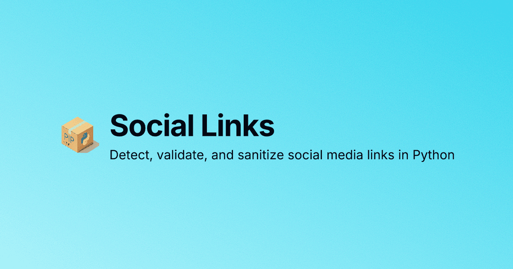

# Social Links

[](https://github.com/ysskrishna/social-links/blob/main/LICENSE)
[](https://github.com/ysskrishna/social-links/actions/workflows/test.yml)

[](https://pypi.org/project/social-links/)
[](https://pepy.tech/projects/social-links)
[](https://ysskrishna.github.io/social-links/)
[](https://ysskrishna.github.io/social-links/demo/)
[](https://ysskrishna.space)
[](https://context7.com/ysskrishna/social-links)
[](https://deepwiki.com/ysskrishna/social-links)

Python library to validate, sanitize, and detect social media URLs. Support for LinkedIn, Instagram, TikTok, X/Twitter, GitHub, Facebook, YouTube, and 185+ platforms. Features automatic URL normalization and zero dependencies. Easy to use, regex-powered, and customizable.


> 🚀 **Try it interactively in your browser!** Test the library with our [Interactive Demo](https://ysskrishna.github.io/social-links/demo/) - no installation required.



## Features

- 🔍 **Auto-detect** social media platforms from URLs
- ✅ **Validate** URLs against specific platforms
- 🧹 **Sanitize** URLs to canonical format
- 🆔 **Extract IDs** (usernames, profile IDs) from URLs
- 🎯 **185+ predefined platforms** (LinkedIn, GitHub, Twitter/X, Facebook, Instagram, YouTube, and more)
- 🔧 **Customizable** - Add your own platforms with regex patterns
- 🚀 **Zero dependencies** - Pure Python, no external libraries

## Installation

```bash
pip install social-links
```

Or using `uv`:

```bash
uv pip install social-links
```

## Quick Start

```python
from sociallinks import detect_platform, sanitize, extract_id, is_valid, list_platforms

# Detect platform from URL
platform = detect_platform("https://www.linkedin.com/in/ysskrishna/")
print(platform)  # "linkedin"

# Validate URL for a specific platform
is_valid_url = is_valid("linkedin", "https://www.linkedin.com/in/ysskrishna/")
print(is_valid_url)  # True

# Sanitize URL to canonical format
sanitized = sanitize("linkedin", "https://www.linkedin.com/in/ysskrishna/")
print(sanitized)  # "https://linkedin.com/in/ysskrishna"

# Extract username/ID from URL
user_id = extract_id("linkedin", "https://www.linkedin.com/in/ysskrishna/")
print(user_id)  # "ysskrishna"

# List all supported platforms
platforms = list_platforms()
print(f"Supported platforms: {len(platforms)}")  # Supported platforms: 185+
```

That's it! For most use cases, you don't need anything more. See [Basic Usage](#basic-usage) for more examples, or [Advanced Usage](#advanced-usage) if you need custom platforms or configurations.

## Supported Platforms

The library comes with 185+ predefined platforms:

<details>
<summary><b>Show all supported platforms</b></summary>

<!-- platforms:start -->

| Predefined Platforms | | |
|---|---|---|
| [500px](https://500px.com) | [Airbnb](https://airbnb.com) | [AniList](https://anilist.co) |
| [Apple Music](https://music.apple.com) | [ArtStation](https://artstation.com) | [AtCoder](https://atcoder.jp) |
| [Audioboom](https://audioboom.com) | [Bandcamp](https://bandcamp.com) | [Beacons](https://beacons.ai) |
| [Behance](https://behance.net) | [Bilibili](https://bilibili.com) | [Bio.link](https://bio.link) |
| [Blogger](https://blogger.com) | [Bluesky](https://bsky.app) | [Buy Me a Coffee](https://buymeacoffee.com) |
| [Campsite.bio](https://campsite.bio) | [Cara](https://cara.app) | [Carrd](https://carrd.co) |
| [Character.AI](https://character.ai) | [Chess.com](https://chess.com) | [Chub.ai](https://chub.ai) (NSFW) |
| [CHZZK](https://chzzk.naver.com) | [Civitai](https://civitai.com) | [ClawHub](https://clawhub.ai) |
| [Codeberg](https://codeberg.org) | [Codecademy](https://codecademy.com) | [CodeChef](https://codechef.com) |
| [Codeforces](https://codeforces.com) | [CodePen](https://codepen.io) | [CodeSandbox](https://codesandbox.io) |
| [Codewars](https://codewars.com) | [Coursera](https://coursera.org) | [crates.io](https://crates.io) |
| [Crunchbase](https://crunchbase.com) | [CSDN](https://csdn.net) | [CurseForge](https://curseforge.com) |
| [Dailymotion](https://dailymotion.com) | [Depop](https://depop.com) | [Dev.to](https://dev.to) |
| [DeviantArt](https://deviantart.com) | [Discogs](https://discogs.com) | [Discord](https://discord.com) |
| [Docker Hub](https://hub.docker.com) | [Douban](https://douban.com) | [Douyin](https://douyin.com) |
| [Douyu](https://douyu.com) | [Dribbble](https://dribbble.com) | [eBay](https://ebay.com) |
| [Etsy](https://etsy.com) | [Exercism](https://exercism.org) | [Facebook](https://facebook.com) |
| [FACEIT](https://faceit.com) | [Fanfix](https://fanfix.io) (NSFW) | [Farcaster](https://farcaster.xyz) |
| [Figma](https://figma.com) | [Fiverr](https://fiverr.com) | [Flickr](https://flickr.com) |
| [Flipboard](https://flipboard.com) | [freeCodeCamp](https://freecodecamp.org) | [Freelancer.com](https://freelancer.com) |
| [Game Jolt](https://gamejolt.com) | [Genius](https://genius.com) | [Gitee](https://gitee.com) |
| [GitHub](https://github.com) | [GitLab](https://gitlab.com) | [GOG](https://gog.com) |
| [Goodreads](https://goodreads.com) | [Google Scholar](https://scholar.google.com) | [Gravatar](https://gravatar.com) |
| [Gumroad](https://gumroad.com) | [Habr](https://habr.com) | [Hacker News](https://news.ycombinator.com) |
| [HackerRank](https://hackerrank.com) | [Hashnode](https://hashnode.com) | [Hey.xyz](https://hey.xyz) |
| [Hoo.be](https://hoo.be) | [Hugging Face](https://huggingface.co) | [Huya](https://huya.com) |
| [Imgur](https://imgur.com) | [iNaturalist](https://inaturalist.org) | [Instagram](https://instagram.com) |
| [itch.io](https://itch.io) | [Jamendo](https://jamendo.com) | [Juejin](https://juejin.cn) |
| [Kaggle](https://kaggle.com) | [Keybase](https://keybase.io) | [Khan Academy](https://khanacademy.org) |
| [Kick](https://kick.com) | [Ko-fi](https://ko-fi.com) | [Kuaishou](https://kuaishou.com) |
| [Last.fm](https://last.fm) | [Launchpad](https://launchpad.net) | [LeetCode](https://leetcode.com) |
| [Lemmy World](https://lemmy.world) | [Lemon8](https://lemon8-app.com) | [Letterboxd](https://letterboxd.com) |
| [Lichess](https://lichess.org) | [LinkedIn](https://linkedin.com) (personal & company) | [Linktree](https://linktr.ee) |
| [Lobsters](https://lobste.rs) | [Mastodon](https://mastodon.social) | [Medium](https://medium.com) |
| [Misskey](https://misskey.io) | [Modrinth](https://modrinth.com) | [MyAnimeList](https://myanimelist.net) |
| [Niconico](https://nicovideo.jp) | [Nimo TV](https://nimo.tv) | [npm](https://npmjs.com) |
| [NuGet](https://nuget.org) | [Odysee](https://odysee.com) | [Ollama](https://ollama.com) |
| [OpenSea](https://opensea.io) | [OpenStreetMap](https://openstreetmap.org) | [ORCID](https://orcid.org) |
| [OSF](https://osf.io) | [osu!](https://osu.ppy.sh) | [Patreon](https://patreon.com) |
| [Pexels](https://pexels.com) | [Pinterest](https://pinterest.com) | [Pixelfed](https://pixelfed.social) |
| [Pixiv](https://pixiv.net) | [Poshmark](https://poshmark.com) | [Primal](https://primal.net) |
| [Product Hunt](https://producthunt.com) | [PyPI](https://pypi.org) | [Qiita](https://qiita.com) |
| [Quora](https://quora.com) | [RateYourMusic](https://rateyourmusic.com) | [Redbubble](https://redbubble.com) |
| [Reddit](https://reddit.com) | [Replicate](https://replicate.com) | [Replit](https://replit.com) |
| [Roblox](https://roblox.com) | [RubyGems](https://rubygems.org) | [Rumble](https://rumble.com) |
| [Rutube](https://rutube.ru) | [Scratch](https://scratch.mit.edu) | [Semantic Scholar](https://semanticscholar.org) |
| [Signal](https://signal.me) | [Sketchfab](https://sketchfab.com) | [SlideShare](https://slideshare.net) |
| [Snapchat](https://snapchat.com) | [solo.to](https://solo.to) | [SOOP (AfreecaTV)](https://sooplive.com) |
| [SoundCloud](https://soundcloud.com) | [SourceForge](https://sourceforge.net) | [SourceHut](https://sr.ht) |
| [Speedrun.com](https://speedrun.com) | [Spotify](https://spotify.com) | [Stack Exchange](https://stackexchange.com) |
| [Stack Overflow](https://stackoverflow.com) | [Stan Store](https://stan.store) | [start.gg](https://start.gg) |
| [Steam](https://steamcommunity.com) | [Substack](https://substack.com) | [Taplink](https://taplink.cc) |
| [Telegram](https://telegram.org) | [The StoryGraph](https://thestorygraph.com) | [Threads](https://threads.com) |
| [Throne](https://throne.com) (NSFW) | [TikTok](https://tiktok.com) | [Tistory](https://tistory.com) |
| [Topcoder](https://topcoder.com) | [Topmate](https://topmate.io) | [Trello](https://trello.com) |
| [Trustpilot](https://trustpilot.com) | [Truth Social](https://truthsocial.com) | [TryHackMe](https://tryhackme.com) |
| [Tumblr](https://tumblr.com) | [Twitch](https://twitch.tv) | [Udemy](https://udemy.com) |
| [Unsplash](https://unsplash.com) | [Untappd](https://untappd.com) | [Vimeo](https://vimeo.com) |
| [VK](https://vk.com) | [Wattpad](https://wattpad.com) | [WeChat](https://weixin.qq.com) |
| [Weibo](https://weibo.com) | [Weights & Biases](https://wandb.ai) | [Wellfound (AngelList)](https://wellfound.com) |
| [WhatsApp](https://whatsapp.com) | [WordPress](https://wordpress.com) | [X (Twitter)](https://x.com) |
| [XDA Forums](https://xdaforums.com) | [Xiaohongshu (RedNote)](https://www.xiaohongshu.com) | [YouTube](https://youtube.com) |
| [Zenn](https://zenn.dev) |  |  |

<!-- platforms:end -->

</details>

## Basic Usage

The simplest way to use social-links is with module-level functions. These work out of the box with 185+ predefined platforms - no configuration needed!

### Detect Platform

```python
from sociallinks import detect_platform

# Detect from full URL
detect_platform("https://github.com/ysskrishna")  # "github"
detect_platform("https://x.com/ysskrishna")      # "x"
detect_platform("https://example.com")           # None

# Works with various URL formats
detect_platform("http://linkedin.com/in/ysskrishna")
detect_platform("www.facebook.com/ysskrishna")
detect_platform("  https://instagram.com/ysskrishna  ")  # Handles whitespace

# Share links with tracking parameters or fragments are accepted
detect_platform("https://www.instagram.com/ysskrishna/?igsh=abc")  # "instagram"
detect_platform("https://github.com/ysskrishna?tab=repositories")  # "github"

# A bare username does not identify a platform
detect_platform("ysskrishna")                    # None
```

### Validate URLs

```python
from sociallinks import is_valid

# Validate against specific platform
is_valid("linkedin", "https://www.linkedin.com/in/ysskrishna/")  # True
is_valid("linkedin", "https://example.com")                   # False
is_valid("github", "https://github.com/ysskrishna")             # True

# A bare username is valid for the platform you name
is_valid("github", "ysskrishna")                                # True

# The URL must start with the platform's URL (no embedded URLs)
is_valid("github", "https://evil.com/?r=https://github.com/ysskrishna")  # False
```

### Sanitize URLs

```python
from sociallinks import sanitize

# Normalize to canonical format
sanitize("linkedin", "https://www.linkedin.com/in/ysskrishna/")
# Returns: "https://linkedin.com/in/ysskrishna"

sanitize("github", "http://www.github.com/ysskrishna")
# Returns: "https://github.com/ysskrishna"

sanitize("x", "https://twitter.com/ysskrishna")
# Returns: "https://x.com/ysskrishna"
```

### Extract IDs

```python
from sociallinks import extract_id

# Extract username/profile ID from URL
extract_id("linkedin", "https://www.linkedin.com/in/ysskrishna/")  # "ysskrishna"
extract_id("github", "https://github.com/ysskrishna")              # "ysskrishna"
extract_id("x", "https://twitter.com/ysskrishna")                  # "ysskrishna"

# Works with company/org URLs too
extract_id("linkedin", "https://linkedin.com/company/acme")  # "acme"
```

### List Platforms

```python
from sociallinks import list_platforms

# Get all available platforms
platforms = list_platforms()
# Returns: ["behance", "dev_to", "dribbble", "github", "linkedin", ...]
print(f"Supported platforms: {len(platforms)}")  # 185+
```

---
## Advanced Usage

For custom configurations, custom platforms, or programmatic platform management, use the `SocialLinks` class directly instead of the module-level functions.

<a id="when-to-use-advanced-features"></a>

<details>
<summary><b>When to Use Advanced Features</b></summary>

Use the class API when you need to:
- Add support for platforms not in the predefined list
- Customize how existing platforms are detected or sanitized
- Manage platforms programmatically (add, remove, modify)
- Configure regex flags or start with an empty platform list

</details>

<a id="using-the-class-api"></a>

<details>
<summary><b>Using the Class API</b></summary>

The `SocialLinks` class provides the same methods as module-level functions, but with additional configuration options:

```python
from sociallinks import SocialLinks

sl = SocialLinks()

# Same methods as module functions
sl.detect_platform("https://github.com/ysskrishna")  # "github"
sl.is_valid("linkedin", "https://linkedin.com/in/user")  # True
sl.sanitize("github", "https://github.com/user")  # "https://github.com/user"
sl.extract_id("github", "https://github.com/user")  # "user"
sl.list_platforms()  # ["behance", "dev_to", "dribbble", ...]
```

#### Configuration Options

```python
from sociallinks import SocialLinks

import re

# Start with empty platform list (useful for custom platforms only)
sl = SocialLinks(use_predefined_platforms=False)

# Configure regex compilation flags
sl = SocialLinks(regex_flags=re.IGNORECASE | re.MULTILINE)
```

</details>

<a id="understanding-platform-configuration"></a>

<details>
<summary><b>Understanding Platform Configuration</b></summary>

<details>
<summary><b>Platform configuration structure and key concepts</b></summary>

A platform configuration is a **list of dictionaries**. Each dictionary contains:
- **`patterns`**: List of regex patterns that match URLs for this platform
- **`sanitized`**: Template string for the canonical URL format

Multiple dictionaries are useful when a platform has different URL types that normalize to different canonical forms (e.g., LinkedIn personal profiles `/in/` vs company pages `/company/`).

#### Configuration Structure

**Single dictionary** - Multiple patterns sharing the same sanitization template:

```python
platform_config = [{
    "patterns": [
        r"https?://(www\.)?example\.com/(?P<id>[A-Za-z0-9_]+)/?$",
        r"https?://example\.com/user/(?P<id>[A-Za-z0-9_]+)/?$"
    ],
    "sanitized": "https://example.com/{id}"
}]
```

**Multiple dictionaries** - Different URL formats with different sanitization templates (e.g., personal profiles vs company pages):

```python
# Example: LinkedIn supports both personal profiles and company pages
platform_config = [
    {
        "patterns": [
            r"https?://(www\.)?linkedin\.com/in/(?P<id>[A-Za-z0-9_-]+)/?$",
            r"https?://linkedin\.com/mwlite/in/(?P<id>[A-Za-z0-9_-]+)/?$"
        ],
        "sanitized": "https://linkedin.com/in/{id}"  # Personal profiles
    },
    {
        "patterns": [
            r"https?://(www\.)?linkedin\.com/company/(?P<id>[A-Za-z0-9_-]+)/?$",
            r"https?://(www\.)?linkedin\.com/school/(?P<id>[A-Za-z0-9_-]+)/?$"
        ],
        "sanitized": "https://linkedin.com/company/{id}"  # Company/school pages
    }
]
```

#### Key Concepts

**Pattern Matching:**
- Use named groups like `(?P<id>...)` to capture identifiers (username, ID, etc.)
- For `detect_platform()`: Platforms are checked in registration order and the first match is returned
- For `sanitize()`: Patterns are checked **in order**, and the **first match** is used

**Sanitization Template:**
- Use `{id}` (or other named groups from patterns) as placeholders
- This defines the canonical URL format returned by `sanitize()`
- The template must contain `{id}` and no other placeholder; otherwise `set_platform()` raises `InvalidPlatformError`

**URL handling:**
- Patterns are matched from the start of the input, so end URL patterns with `/?$`
- If nothing matches, the input is tried again without its query string and fragment, so share links work
- Patterns that are only a bare ID (such as `^{PROFILE_ID}$`, built from `sociallinks.constants`) are skipped by `detect_platform()` but still accepted by `is_valid()`, `sanitize()` and `extract_id()`

</details>

</details>

## Adding Custom Platforms

#### Basic Example

```python
from sociallinks import SocialLinks

sl = SocialLinks(use_predefined_platforms=False)

# Define a custom platform
custom_platform = [{
    "patterns": [
        r"https?://(www\.)?example\.com/(?P<id>[A-Za-z0-9_]+)/?$",
        r"https?://example\.com/user/(?P<id>[A-Za-z0-9_]+)/?$"
    ],
    "sanitized": "https://example.com/{id}"
}]

# Register the platform
sl.set_platform("example", custom_platform)

# Use it
sl.detect_platform("https://example.com/user123")  # "example"
sl.sanitize("example", "https://www.example.com/user123/")  # "https://example.com/user123"
```

<details>
<summary><b>Handling multiple URL formats</b></summary>

#### Handling Multiple URL Formats

When a platform supports different URL formats that normalize to **different** canonical forms (e.g., personal profiles vs company pages):

```python
from sociallinks import SocialLinks

sl = SocialLinks(use_predefined_platforms=False)

# Example: Platform with personal profiles and company pages
linkedin_style_platform = [
    {
        "patterns": [
            r"https?://(www\.)?example\.com/profile/(?P<id>[A-Za-z0-9_-]+)/?$",
            r"https?://(www\.)?example\.com/user/(?P<id>[A-Za-z0-9_-]+)/?$"
        ],
        "sanitized": "https://example.com/profile/{id}"  # Personal profiles
    },
    {
        "patterns": [
            r"https?://(www\.)?example\.com/company/(?P<id>[A-Za-z0-9_-]+)/?$",
            r"https?://(www\.)?example\.com/org/(?P<id>[A-Za-z0-9_-]+)/?$"
        ],
        "sanitized": "https://example.com/company/{id}"  # Company pages
    }
]

sl.set_platform("example", linkedin_style_platform)

# Personal profile URLs normalize to /profile/
sl.sanitize("example", "https://www.example.com/user/johndoe")  
# Returns: "https://example.com/profile/johndoe"

# Company URLs normalize to /company/
sl.sanitize("example", "https://www.example.com/org/acme-corp")  
# Returns: "https://example.com/company/acme-corp"
```

</details>

<a id="managing-platforms"></a>

<details>
<summary><b>Managing Platforms</b></summary>

<details>
<summary><b>View, add, modify and remove platforms</b></summary>

#### Viewing Platform Configurations

```python
from sociallinks import SocialLinks

sl = SocialLinks()

# Get configuration for an existing platform
github_config = sl.get_platform("github")
print(github_config)  # See the patterns and sanitized template

# List all available platforms
platforms = sl.list_platforms()
# Returns: ["behance", "dev_to", "dribbble", "github", "linkedin", ...]
```

#### Adding Platforms

```python
from sociallinks import SocialLinks

sl = SocialLinks()

# Add a new platform (raises error if platform already exists)
custom_platform = [{
    "patterns": [r"https?://example.com/(?P<id>[A-Za-z0-9_]+)"],
    "sanitized": "https://example.com/{id}"
}]
sl.set_platform("example", custom_platform)

# Override an existing platform (including predefined ones)
sl.set_platform("github", custom_platform, override=True)
```

#### Adding Multiple Platforms

```python
from sociallinks import SocialLinks

sl = SocialLinks()

# Add multiple platforms at once
new_platforms = {
    "platform1": [{
        "patterns": [r"https?://example1.com/(?P<id>[A-Za-z0-9_]+)"],
        "sanitized": "https://example1.com/{id}"
    }],
    "platform2": [{
        "patterns": [r"https?://example2.com/(?P<id>[A-Za-z0-9_]+)"],
        "sanitized": "https://example2.com/{id}"
    }]
}

sl.set_platforms(new_platforms, override=False)  # Raises error if any exist
sl.set_platforms(new_platforms, override=True)   # Overrides existing platforms
```

#### Modifying Existing Platforms

```python
from sociallinks import SocialLinks

sl = SocialLinks()

# Get existing configuration
github_config = sl.get_platform("github")

# Modify and override
custom_github = [{
    "patterns": [r"https?://github\.com/(?P<id>[A-Za-z0-9_]+)/?$"],
    "sanitized": "https://github.com/{id}"
}]
sl.set_platform("github", custom_github, override=True)
```

#### Removing Platforms

```python
from sociallinks import SocialLinks

sl = SocialLinks()

# Delete a single platform
sl.delete_platform("custom_platform")

# Delete multiple platforms
sl.delete_platforms(["platform1", "platform2"])

# Clear all platforms
sl.clear_platforms()
```

Registration is all-or-nothing: if a configuration is invalid, `set_platform()` and
`set_platforms()` raise and leave the existing platforms untouched.

</details>

</details>

<a id="complete-example"></a>

<details>
<summary><b>Complete Example</b></summary>

<details>
<summary><b>Build a custom platform manager</b></summary>

Here's a complete example showing how to build a custom platform manager:

```python
from sociallinks import is_valid

from sociallinks import SocialLinks

# Start with predefined platforms
sl = SocialLinks()

# Add a custom platform
my_platform = [{
    "patterns": [
        r"https?://(www\.)?mysite\.com/profile/(?P<id>[A-Za-z0-9_]+)/?$",
        r"https?://(www\.)?mysite\.com/u/(?P<id>[A-Za-z0-9_]+)/?$"
    ],
    "sanitized": "https://mysite.com/profile/{id}"
}]
sl.set_platform("mysite", my_platform)

# Use it
url = "https://www.mysite.com/u/johndoe"
platform = sl.detect_platform(url)  # "mysite"
sanitized = sl.sanitize(platform, url)  # "https://mysite.com/profile/johndoe"
user_id = sl.extract_id(platform, url)  # "johndoe"
is_valid = sl.is_valid(platform, url)  # True

# View all platforms
all_platforms = sl.list_platforms()
print(f"Total platforms: {len(all_platforms)}")
```

</details>

</details>

## API Reference

Every public function, `SocialLinks` method and exception, with parameters, return values and examples, is listed in [API.md](API.md).

## Roadmap

<details>
<summary><b>Planned improvements</b></summary>

- [ ] Add method to configure custom sanitization patterns
- [x] Lint with ruff in CI
- [ ] Add a formatter (black or `ruff format`) and isort-style import sorting
- [ ] Add code coverage reporting with pytest-cov
- [ ] Refactor platform entries using dataclasses for better structure

</details>

## Contributing

Contributions are welcome! Please read our [Contributing Guide](https://github.com/ysskrishna/social-links/blob/main/CONTRIBUTING.md) for details on our code of conduct, development setup, and the process for submitting pull requests.

## Credits

This package is inspired by the [social-links](https://www.npmjs.com/package/social-links) npm package by [gkucmierz](https://github.com/gkucmierz/social-links).

## Built and maintained by

Social Links is built and maintained by:

| | Name | GitHub | Role |
|---|------|--------|------|
|  | **Y. Siva Sai Krishna** | [@ysskrishna](https://github.com/ysskrishna) | Creator |

## Changelog

See [CHANGELOG](CHANGELOG.md) for release history.

## Support

If you find this library helpful:

- ⭐ Star the repository
- 🐛 [Report issues](https://github.com/ysskrishna/social-links/issues)
- 🔀 Submit pull requests
- 💝 [Sponsor on GitHub](https://github.com/sponsors/ysskrishna)

## License

MIT © [Y. Siva Sai Krishna](https://github.com/ysskrishna) — see [LICENSE](LICENSE) for details.

---

<p align="left">
  <a href="https://github.com/ysskrishna">Author's GitHub</a> •
  <a href="https://linkedin.com/in/ysskrishna">Author's LinkedIn</a> •
  <a href="https://ysskrishna.space">Author's site</a> •
  <a href="https://pypi.org/project/social-links/">Package on PyPI</a> •
  <a href="https://clawhub.ai/ysskrishna">ClawHub</a> •
  <a href="https://ysskrishna.github.io/social-links/">Package Documentation</a> •
  <a href="https://ysskrishna.github.io/social-links/demo/">Interactive Demo</a> •
  <a href="https://github.com/ysskrishna/social-links/issues">Report Issues</a>
</p>
